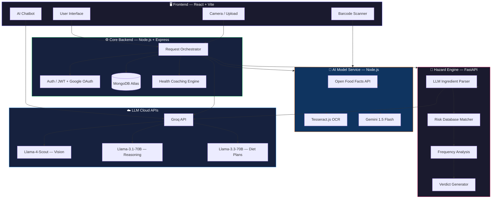

<div align="center">

# 🧬 Nutralyze

### **Multimodal LLM-Driven Nutrition Analysis, Ingredient Risk Detection & Personalized Dietary Guidance**

<br/>

[](#)
[](#-tech-stack)
[](#)
[](#)
[](#-deployment)

<br/>

**Snap a photo. Scan a barcode. Know exactly what you're eating.**

Nutralyze is a full-stack AI platform that transforms how people understand food — combining multimodal LLM vision, OCR-powered ingredient forensics, regulatory risk scoring, and personalized diet intelligence into a single, beautiful experience.

<br/>

[Live Demo](https://nutrivision-oc9q.onrender.com) · [Report Bug](https://github.com/akkiiop/Nutralyze/issues) · [Request Feature](https://github.com/akkiiop/Nutralyze/issues)

---

</div>

<br/>

## 📋 Table of Contents

- [Why Nutralyze?](#-why-nutralyze)
- [Key Features](#-key-features)
- [System Architecture](#-system-architecture)
- [AI Pipeline Deep Dive](#-ai-pipeline-deep-dive)
- [Tech Stack](#-tech-stack)
- [Getting Started](#-getting-started)
- [Environment Variables](#-environment-variables)
- [Project Structure](#-project-structure)
- [Deployment](#-deployment)
- [Research & Results](#-research--results)
- [Contributing](#-contributing)
- [Authors](#-authors)
- [License](#-license)

<br/>

## 💡 Why Nutralyze?

Most nutrition apps ask you to **manually search and log** every meal — tedious, error-prone, and unsustainable.

Nutralyze takes a fundamentally different approach:

| Traditional Apps | Nutralyze |
|:---|:---|
| Manual text search for foods | 📸 **Snap a photo** — AI identifies & estimates nutrition |
| Fixed food databases (~thousands) | 🧠 **LLM knowledge** — covers global cuisines without a fixed taxonomy |
| No ingredient safety analysis | 🛡️ **20-phase hazard engine** — detects hidden dangers in packaged food |
| Generic diet suggestions | 🎯 **Context-aware plans** — considers your health profile, allergies, and today's intake |
| English-only chatbots | 🌐 **Multilingual AI** — English, Hindi, Marathi nutrition guidance |

> **Research-backed**: Achieves **10.07% MAPE** on caloric estimation and **95.98% F1-score** on OCR ingredient parsing — validated against USDA and IFCT ground truth.

<br/>

## ✨ Key Features

<table>
<tr>
<td width="50%">

### 🔍 Smart Food Scanner
Point your camera at **any food** — fresh, cooked, or packaged. The dual-stage LLM pipeline (Llama-4-Scout vision → Llama-3.1-70B reasoning) identifies the food, estimates portion size, and computes full macronutrient breakdown in seconds.

</td>
<td width="50%">

### 🛡️ Ingredient Risk Engine
Scan a barcode or photograph the ingredient label. The **20-phase hazard analysis** engine cross-references against FSSAI, FDA, and EU regulatory databases with kill-switch detection for critically dangerous additives.

</td>
</tr>
<tr>
<td width="50%">

### 📊 Progress Dashboard
Track calories, macros, and weight over time with interactive charts. **Streak tracking** (up to 365 days), weekly/monthly trends, and rule-based health coaching that alerts you when protein dips below 60% or sugar exceeds limits.

</td>
<td width="50%">

### 🥗 AI Diet Planner
Get personalized daily meal plans that respect your dietary type (veg/vegan/keto/Jain), allergies, medical conditions, and remaining macro budget — powered by Llama-3.3-70B with deterministic fallback guarantees.

</td>
</tr>
<tr>
<td width="50%">

### 💬 Multilingual AI Chatbot
A 24/7 nutrition assistant powered by Groq LLM supporting **English, Hindi, and Marathi**. Ask anything about diets, nutrients, food combinations, or health conditions.

</td>
<td width="50%">

### 📦 Package Food Scanner
Scan barcodes to fetch data from **Open Food Facts** (1M+ products), or use OCR to read ingredient labels directly. Toggle between per-100g and per-serving nutritional views.

</td>
</tr>
</table>

<br/>

## 🏗 System Architecture

Nutralyze follows a **service-oriented architecture** with three specialized backend services orchestrated behind a React frontend:



<br/>

## 🧠 AI Pipeline Deep Dive

### 1. Food Recognition — Dual-Stage LLM Pipeline

```
📸 Image Upload
    │
    ▼
┌─────────────────────────────────┐
│  Stage 1: Visual Identification │
│  Model: Llama-4-Scout-17B       │
│  Input: Base64 image (512×512)  │
│  Output: Food name, portion,    │
│          weight estimate, conf.  │
└──────────────┬──────────────────┘
               │
               ▼
┌─────────────────────────────────┐
│  Stage 2: Nutrition Estimation  │
│  Model: Llama-3.1-70B           │
│  Input: Food identity + portion │
│  Output: Calories, protein,     │
│          carbs, fats, fiber,     │
│          sugar, Nutri-Score      │
└──────────────┬──────────────────┘
               │
               ▼
┌─────────────────────────────────┐
│  Safety Fallback Layer          │
│  Category-based density calc:   │
│  E = W_est × ρ_category        │
│  (prevents zero-calorie errors) │
└─────────────────────────────────┘
```

### 2. Ingredient Risk Scoring — 20-Phase Hazard Engine

Each ingredient is evaluated through a **weighted scoring formula**:

```
S_total = Σ (Rᵢ × Wᵢ)
```

Where severity weights are non-linearly assigned:

| Risk Score (Rᵢ) | Weight (Wᵢ) | Category |
|:---:|:---:|:---|
| ≥ 90 | 2.5 | ☠️ Critical — Kill-switch substances |
| 70–89 | 1.5 | 🔴 High — Significant health concern |
| 40–69 | 0.8 | 🟡 Moderate — Consume with awareness |
| < 40 | 0.3 | 🟢 Low — Generally safe |

**Verdicts:**

| Total Score | Verdict | Recommendation |
|:---:|:---|:---|
| Kill-switch | 🚫 **Avoid** | Do not consume |
| > 150 | ⚠️ **Occasional** | Once per month max |
| > 80 | 🔶 **Moderation** | 2–3 times per week |
| > 25 | 📋 **Monitor** | Generally good, stay aware |
| ≤ 25 | ✅ **Daily Safe** | No concerns detected |

### 3. Calorie Target Computation

User-specific targets use the **Mifflin-St Jeor equation**:

```
BMR (male)   = 10w + 6.25h - 5a + 5
BMR (female) = 10w + 6.25h - 5a - 161

TDEE = BMR × Activity Multiplier (1.2 → 1.9)
```

<br/>

## 🛠 Tech Stack

<table>
<tr>
<th>Layer</th>
<th>Technologies</th>
</tr>
<tr>
<td><strong>Frontend</strong></td>
<td>


</td>
</tr>
<tr>
<td><strong>Backend</strong></td>
<td>


</td>
</tr>
<tr>
<td><strong>AI / ML</strong></td>
<td>


</td>
</tr>
<tr>
<td><strong>LLMs</strong></td>
<td>


</td>
</tr>
<tr>
<td><strong>Auth</strong></td>
<td>


</td>
</tr>
<tr>
<td><strong>DevOps</strong></td>
<td>


</td>
</tr>
</table>

<br/>

## 🚀 Getting Started

### Prerequisites

| Requirement | Version |
|:---|:---|
| Node.js | `v18+` |
| Python | `3.9+` (for hazard engine) |
| MongoDB Atlas | Free tier works |
| Groq API Key | [Get one here](https://console.groq.com) |
| Google Gemini API Key | [Get one here](https://aistudio.google.com/apikey) |
| Google Cloud Console | For OAuth credentials |

### 1️⃣ Clone & Install

```bash
# Clone the repository
git clone https://github.com/akkiiop/Nutralyze.git
cd Nutralyze

# Install all dependencies (client + server + AI model)
npm run install-all
```

### 2️⃣ Configure Environment

Create `.env` files in the following directories using the provided `.env.example` templates:

**`server/.env`**
```env
PORT=8080
MONGO_URI=mongodb+srv://<user>:<pass>@cluster.mongodb.net/nutralyze
JWT_SECRET=your_jwt_secret
GROQ_API_KEY=gsk_...
GOOGLE_CLIENT_ID=your_google_oauth_client_id
GEMINI_API_KEY=your_gemini_api_key
```

**`AI-model/.env`**
```env
PORT=5000
GROQ_API_KEY=gsk_...
GEMINI_API_KEY=your_gemini_api_key
```

**`client/.env`**
```env
VITE_API_URL=http://localhost:8080
VITE_AI_MODEL_URL=http://localhost:5000
VITE_GOOGLE_CLIENT_ID=your_google_oauth_client_id
```

### 3️⃣ Start the Python Hazard Engine

```bash
cd AI-model
pip install -r requirements.txt
python -m uvicorn ml.service:app --host 0.0.0.0 --port 8002
```

### 4️⃣ Launch All Services

```bash
# From the project root — starts client, server, and AI model concurrently
npm run dev
```

| Service | URL | Description |
|:---|:---|:---|
| 🖥️ Frontend | `http://localhost:3000` | React application |
| ⚙️ API Server | `http://localhost:8080` | Core backend |
| 🤖 AI Model | `http://localhost:5000` | AI microservice |
| 🧪 Hazard Engine | `http://localhost:8002` | Python risk analyzer |

<br/>

## 🔐 Environment Variables

<details>
<summary><strong>Click to expand full environment variable reference</strong></summary>

| Variable | Service | Required | Description |
|:---|:---|:---:|:---|
| `MONGO_URI` | Server | ✅ | MongoDB Atlas connection string |
| `JWT_SECRET` | Server | ✅ | Secret key for JWT token signing |
| `GROQ_API_KEY` | Server, AI-model, Python | ✅ | Groq Cloud API key for LLM inference |
| `GEMINI_API_KEY` | Server, AI-model | ✅ | Google Gemini API key |
| `GOOGLE_CLIENT_ID` | Server | ✅ | Google OAuth 2.0 client ID |
| `VITE_API_URL` | Client | ✅ | Backend API endpoint |
| `VITE_AI_MODEL_URL` | Client | ✅ | AI model service endpoint |
| `VITE_GOOGLE_CLIENT_ID` | Client | ✅ | Public Google OAuth client ID |
| `VITE_FIREBASE_*` | Client | ⬜ | Firebase config (optional, for social auth) |
| `CORS_ORIGINS` | Server | ⬜ | Allowed CORS origins (comma-separated) |

</details>

<br/>

## 📁 Project Structure

```
Nutralyze/
│
├── client/                     # 🖥️  React Frontend
│   ├── src/
│   │   ├── components/         # Reusable UI components
│   │   │   ├── chat/           #   └─ AI Chatbot interface
│   │   │   ├── progress/       #   └─ Progress tracking charts
│   │   │   ├── layout/         #   └─ App layout & navigation
│   │   │   └── auth/           #   └─ Authentication components
│   │   ├── pages/              # Route-level page components
│   │   │   ├── Dashboard.jsx   #   └─ Main food scanner & dashboard
│   │   │   ├── MealLog.jsx     #   └─ Daily meal tracking
│   │   │   ├── DietPlan.jsx    #   └─ AI-generated diet plans
│   │   │   ├── Progress.jsx    #   └─ Weight & nutrition trends
│   │   │   ├── PackageFood/    #   └─ Barcode scanner & label analysis
│   │   │   ├── Profile.jsx     #   └─ User health profile
│   │   │   └── Onboarding.jsx  #   └─ First-time setup wizard
│   │   ├── contexts/           # React Context providers
│   │   ├── services/           # API service layer (axios)
│   │   └── theme.js            # MUI theme configuration
│   └── package.json
│
├── server/                     # ⚙️  Core Backend API
│   ├── controllers/            # Route handlers
│   ├── models/                 # Mongoose schemas (User, Meal, DailySummary)
│   ├── routes/                 # Express route definitions
│   ├── services/               # Business logic services
│   ├── middleware/              # Auth, rate limiting, error handling
│   ├── ml/                     # Server-side ML utilities
│   │   └── data/
│   │       └── ingredients_db.json  # Curated additive risk database
│   ├── tests/                  # Vitest test suites
│   └── app.js                  # Server entry point
│
├── AI-model/                   # 🤖 AI Microservice
│   ├── controllers/            # Detection & analysis controllers
│   ├── services/               # Gemini & OCR service layer
│   ├── routes/                 # API routes
│   ├── ml/                     # Python hazard engine
│   │   ├── service.py          #   └─ FastAPI — 20-phase analysis
│   │   └── data/
│   │       └── ingredients_db.json  # Risk-scored additive database
│   ├── eng.traineddata         # Tesseract OCR language model
│   └── server.js               # Microservice entry point
│
├── adapters/                   # 🔌 LLM Adapter Documentation
│   ├── CLAUDE.md
│   ├── GEMINI.md
│   └── GPT_OSS.md
│
├── docs/                       # 📚 Documentation
│   ├── runbook.md
│   ├── model-selection-playbook.md
│   └── token-optimization-guide.md
│
├── Dockerfile                  # 🐳 Multi-stage Docker build
├── render.json                 # ☁️  Render.com deployment config
├── package.json                # Root orchestration scripts
└── README.md
```

<br/>

## ☁️ Deployment

### Docker (Recommended)

```bash
# Build the production image
docker build \
  --build-arg VITE_GOOGLE_CLIENT_ID=your_client_id \
  -t nutralyze .

# Run the container
docker run -p 8080:8080 \
  -e MONGO_URI=your_mongo_uri \
  -e JWT_SECRET=your_secret \
  -e GROQ_API_KEY=your_groq_key \
  -e GEMINI_API_KEY=your_gemini_key \
  -e GOOGLE_CLIENT_ID=your_client_id \
  nutralyze
```

### Render.com (One-Click)

The repo includes a pre-configured [`render.json`](render.json) blueprint. Simply:

1. Fork this repository
2. Connect your fork to [Render](https://render.com)
3. Set the environment variables in Render's dashboard
4. Deploy 🚀

**Live instance**: [https://nutrivision-oc9q.onrender.com](https://nutrivision-oc9q.onrender.com)

<br/>

## 📊 Research & Results

Nutralyze was developed as part of an academic research project and evaluated empirically:

### Performance Metrics

| Metric | Value | Benchmark |
|:---|:---:|:---|
| Caloric Estimation MAPE | **10.07%** | 15 foods vs. USDA & IFCT |
| Overall Macronutrient MAPE | **29.64%** | Protein, carbs, fats, fiber |
| OCR Ingredient Precision | **94.57%** | 10 packaged food labels |
| OCR Ingredient Recall | **97.74%** | Complex compound ingredients |
| OCR Ingredient F1-Score | **95.98%** | End-to-end parsing accuracy |
| Harmful Additive Detection | **100%** | 5/5 products with known hazards |

### Advantages Over Traditional CNN Approaches

- ✅ **Zero training overhead** — no dataset collection, annotation, or model training
- ✅ **Unlimited food vocabulary** — LLM pre-trained knowledge covers global cuisines
- ✅ **Contextual reasoning** — interprets packaging, plating, and visual context
- ✅ **Prompt-driven iteration** — improve accuracy through prompt engineering, not retraining
- ✅ **Structured output** — JSON responses integrate directly with downstream systems

> 📄 **Full Research Paper**: See [`Nutralyze_Paper_Final.md`](Nutralyze_Paper_Final.md) for the complete academic paper with methodology, experimental setup, and detailed results.

<br/>

## 🤝 Contributing

Contributions are welcome! Here's how to get started:

```bash
# 1. Fork the repository
# 2. Create your feature branch
git checkout -b feature/amazing-feature

# 3. Make your changes and commit
git commit -m "feat: add amazing feature"

# 4. Push to the branch
git push origin feature/amazing-feature

# 5. Open a Pull Request
```

<br/>

## 👨‍💻 Authors

**Department of Computer Engineering**  
Dr. Vithalrao Vikhe Patil College of Engineering, Ahilyanagar, India

| Name | Role |
|:---|:---|
| Dipak J. Baviskar | Developer |
| Pranav B. Ippalpelli | Developer |
| Akshay B. Kawade | Developer |
| Pravin B. Wadekar | Developer |
| Prof. Narayan B. Vikhe | Guide |
| Prof. Madhavi S. Kale | Guide |

<br/>

## 📄 License

Distributed under the **ISC License**. See `LICENSE` for more information.

---

<div align="center">

**Built with ❤️ and a lot of 🧬 science**

<br/>

<sub>If Nutralyze helped you, consider giving it a ⭐ on GitHub!</sub>

</div>
