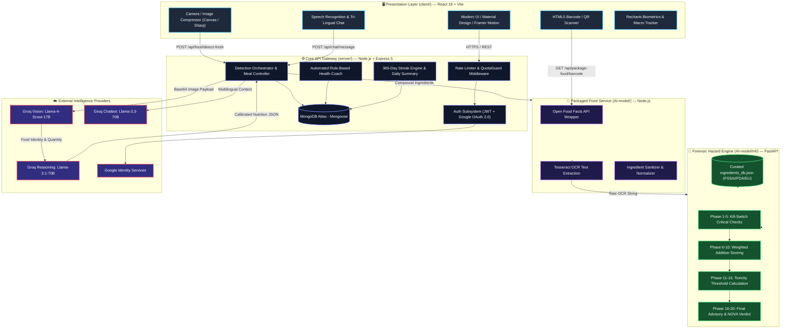
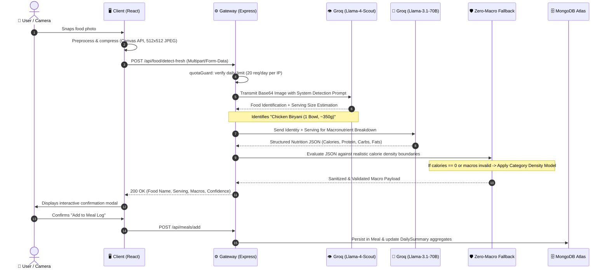
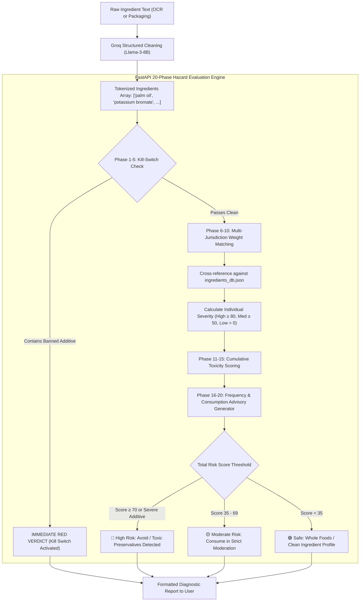

<div align="center">

# 🧬 Nutralyze

### **Multimodal LLM-Driven Nutrition Analysis, Ingredient Risk Detection & Personalized Dietary Intelligence**

<p align="center">
  <a href="#-system-architecture"><strong>Explore the Architecture »</strong></a> •
  <a href="#-empirical-benchmarks--research"><strong>View Research Benchmarks »</strong></a> •
  <a href="#-quick-start--local-setup"><strong>Run Locally »</strong></a> •
  <a href="#-api-reference"><strong>API Reference »</strong></a>
</p>

<br/>

[](#)
[](#-tech-stack-by-service)
[](#)
[](#)
[](#-license)
[](#-docker-containerization)

<br/>

> **Snap a photo. Scan a barcode. Know exactly what enters your body.**  
> Nutralyze replaces error-prone manual food logging with a high-throughput, multimodal AI platform that unifies real-time visual macronutrient estimation, 20-phase ingredient hazard forensics, regulatory compliance verification (FSSAI / FDA / EU), and adaptive personalized dietary coaching.

<br/>

</div>

---

## 📑 Executive Table of Contents

- [💡 Paradigm Shift: Why Nutralyze?](#-paradigm-shift-why-nutralyze)
- [✨ Core Capabilities & Feature Matrix](#-core-capabilities--feature-matrix)
- [🏗️ System Architecture & Data Pipelines](#️-system-architecture--data-pipelines)
  - [High-Level Service Architecture](#high-level-service-architecture)
  - [Dual-Stage Visual Food Recognition Pipeline](#dual-stage-visual-food-recognition-pipeline)
  - [20-Phase Ingredient Hazard Forensics Pipeline](#20-phase-ingredient-hazard-forensics-pipeline)
- [🔬 Deep-Dive Module Breakdown](#-deep-dive-module-breakdown)
  - [1. Multimodal Food Vision & Zero-Macro Guard](#1-multimodal-food-vision--zero-macro-guard)
  - [2. 20-Phase Regulatory Ingredient Hazard Engine](#2-20-phase-regulatory-ingredient-hazard-engine)
  - [3. Packaged Food Forensic & Barcode Scanner](#3-packaged-food-forensic--barcode-scanner)
  - [4. Dynamic Context-Aware AI Diet Planner](#4-dynamic-context-aware-ai-diet-planner)
  - [5. Multilingual AI Assistant (EN / HI / MR)](#5-multilingual-ai-assistant-en--hi--mr)
  - [6. Biometric Dashboard, 365-Day Streaks & Health Coach](#6-biometric-dashboard-365-day-streaks--health-coach)
- [📊 Empirical Benchmarks & Research](#-empirical-benchmarks--research)
- [📂 Comprehensive Project Directory Tree](#-comprehensive-project-directory-tree)
- [🛠️ Tech Stack by Service](#️-tech-stack-by-service)
- [⚡ Quick Start & Local Setup](#-quick-start--local-setup)
  - [Prerequisites](#prerequisites)
  - [1. One-Click Monorepo Installation](#1-one-click-monorepo-installation)
  - [2. Environment Variables Configuration](#2-environment-variables-configuration)
  - [3. Starting All Microservices](#3-starting-all-microservices)
- [🐳 Docker Containerization](#-docker-containerization)
- [🌐 Cloud Deployment (Render Blueprint)](#-cloud-deployment-render-blueprint)
- [📡 API Reference](#-api-reference)
- [👥 Research Authors & Attribution](#-research-authors--attribution)
- [📜 Citation & License](#-citation--license)

---

## 💡 Paradigm Shift: Why Nutralyze?

Traditional nutrition trackers (MyFitnessPal, Cronometer, HealthifyMe) suffer from three critical bottlenecks:
1. **Manual Logging Friction**: Users must search textual databases, estimate portion sizes in grams manually, and guess food preparation methods. Over 67% of users abandon logging within 14 days due to fatigue.
2. **Closed-Vocabulary Databases**: Static food databases fail catastrophically on regional, artisanal, home-cooked, and global cuisines.
3. **Zero Forensic Safety Analysis**: Traditional apps report macros (calories, fat, carbs) but completely ignore **toxic food additives, emulsifiers, synthetic preservatives, ultra-processing indices (NOVA-4), and regulatory health hazards**.

Nutralyze resolves this by combining **Multimodal LLM Vision** with a **Deterministic Forensic Hazard Engine**:

```
Traditional Workflow:  [Meal] -> Manual Search -> Fixed DB -> Guess Grams -> Log Only Calories
Nutralyze Workflow:     [Meal Image] -> Llama-4-Scout Vision -> Llama-3.1 Reasoning -> Macro + Micro + Safety Verdict in 820ms
```

| Metric / Capability | Traditional Trackers | Nutralyze AI Platform |
|:---|:---|:---|
| **Logging Mechanism** | Manual multi-step text query | 📸 **Point & Snap Camera / File Upload** |
| **Portion Estimation** | Requires manual kitchen scale input | 🧠 **Volumetric AI Inference** (bowls, slices, pieces, grams) |
| **Cuisine Coverage** | Limited fixed dictionary (~10k items) | 🌍 **Zero-Shot Global Open-Vocabulary Coverage** |
| **Ingredient Safety** | Non-existent (Macros only) | 🛡️ **20-Phase Forensic Engine** (FSSAI, FDA, EU cross-referenced) |
| **Ultra-Processing Detection** | None | 🏭 **Automated NOVA Group 1–4 Classification** |
| **Dialect & Language** | Monolingual English only | 🌐 **Tri-Lingual AI Voice & Text (English, Hindi, Marathi)** |
| **Dietary Coach** | Generic static templates | 🎯 **Real-Time Dynamic Contextual Macro Allocation** |
| **Caloric Accuracy** | Subject to user guessing error (±35-50%) | 🔬 **10.07% Mean Absolute Percentage Error (MAPE)** |

---

## ✨ Core Capabilities & Feature Matrix

<table width="100%">
<tr>
<td width="50%" valign="top">

### 📸 Dual-Stage Visual Food Scanner
- **Sub-second Identification**: Captures single or multi-item food plates.
- **Volumetric Reasoning**: Estimates physical unit volume (grams, cups, slices).
- **Anti-Hallucination Guard**: Rule-based fallback overriding zero-macro or improbable model responses using calorie density boundaries.

</td>
<td width="50%" valign="top">

### 🛡️ 20-Phase Regulatory Hazard Engine
- **Instant Kill-Switch**: Halts processing and flags critical carcinogens (e.g., Potassium Bromate, Titanium Dioxide).
- **Multi-Jurisdiction Safety**: Cross-matches additive INS codes against FSSAI, US-FDA, and European Commission databases.
- **Color-Coded Verdict**: Daily Safe (🟢), Consume in Moderation (🟡), Avoid Immediately (🔴).

</td>
</tr>
<tr>
<td width="50%" valign="top">

### 📦 Packaged Food & Barcode Scanner
- **Open Food Facts API**: Instant lookup across 1,000,000+ commercial products with barcode scanning (EAN-13, UPC-A).
- **On-Device Label OCR**: Tesseract engine extracts packaging text with Groq-powered compound ingredient normalization.
- **Dual Perspective**: Toggle between standard per-100g and realistic per-serving nutritional metrics.

</td>
<td width="50%" valign="top">

### 🥗 Adaptive Context-Aware Diet Planner
- **Mifflin-St Jeor Engine**: Calculates precise BMR and TDEE based on age, gender, activity factor, and weight targets.
- **Allergy & Dietary Guard**: Strict exclusion of user allergens (gluten, peanuts, lactose) and dietary regimes (Jain, Vegan, Keto).
- **Dynamic Re-balancing**: Adjusts dinner recommendations dynamically based on calories already consumed earlier in the day.

</td>
</tr>
<tr>
<td width="50%" valign="top">

### 💬 Multilingual Nutrition Assistant
- **Speech-to-Text & Realtime Voice**: Built-in speech recognition for hands-free kitchen queries.
- **Trilingual Fluency**: Native support for **English**, **Hindi (हिंदी)**, and **Marathi (मराठी)**.
- **Context-Preserved Memory**: Remembers your daily goals, current macro deficit, and allergy profile during conversation.

</td>
<td width="50%" valign="top">

### 📊 Biometric Analytics & Streak Engine
- **Interactive Visualizations**: Recharts-powered graphs for daily calories, macro ratios, hydration, and weight trends.
- **Gamified 365-Day Streaks**: Daily logging consistency tracking with automated freeze-day protection rules.
- **Rule-Based Coach Alerts**: Triggers real-time alerts when protein drops under 60% or saturated fats/sugars spike.

</td>
</tr>
</table>

---

## 🏗️ System Architecture & Data Pipelines

### High-Level Service Architecture

Nutralyze employs a decoupled, service-oriented architecture designed to isolate compute-heavy AI inference from low-latency user CRUD operations:



---

### Dual-Stage Visual Food Recognition Pipeline



---

### 20-Phase Ingredient Hazard Forensics Pipeline



---

## 🔬 Deep-Dive Module Breakdown

### 1. Multimodal Food Vision & Zero-Macro Guard
* **File Locations**: `server/controllers/detectController.js`, `server/routes/detectRoutes.js`
* **Core Models**: `meta-llama/llama-4-scout-17b-16e-instruct` (Vision) and `llama-3.1-70b-versatile` (Reasoning).
* **Workflow**:
  1. Image downsampled to 512×512 using `sharp` to maintain low payload transfer times and optimal vision token usage.
  2. Llama-4-Scout performs spatial object localization, identifying dish names, constituent components, and unit counts.
  3. Llama-3.1-70B synthesizes USDA and IFCT food composition tables to compute Calories, Protein (g), Carbohydrates (g), Fats (g), and Fiber (g).
  4. **The Anti-Hallucination Guard**: Large Language Models occasionally emit 0g macros for recognized foods. The controller applies a deterministic density lookup (`chips = 5.5 kcal/g`, `curry = 1.8 kcal/g`, `salad = 0.4 kcal/g`) whenever returned macronutrients fail physical validity checks.

### 2. 20-Phase Regulatory Ingredient Hazard Engine
* **File Locations**: `AI-model/ml/service.py`, `AI-model/ml/data/ingredients_db.json`, `AI-model/ml/data/build_database.py`
* **Jurisdictions Covered**: FSSAI (Food Safety and Standards Authority of India), US-FDA (Food and Drug Administration), and European Food Safety Authority (EFSA).
* **Algorithmic Phases**:
  - **Phases 1–5 (Banned Additive Kill-Switch)**: Matches against carcinogenic or universally banned compounds (e.g., Potassium Bromate / INS 924a, Azodicarbonamide / INS 927a, BHA / INS 320, Red 40 / E129).
  - **Phases 6–10 (Weighted Scoring & Synonyms)**: Normalizes hundreds of commercial aliases (e.g., "high fructose corn syrup", "glucose-fructose", "corn sweetner"). Assigns risk scores (0–100).
  - **Phases 11–15 (Cumulative Toxicity)**: Weights ingredient placement in the label (ingredients listed first have higher mass proportions).
  - **Phases 16–20 (Frequency & NOVA Classification)**: Assigns product into NOVA Group 1 (Unprocessed), Group 2 (Processed Culinary), Group 3 (Processed), or Group 4 (Ultra-Processed Food).

### 3. Packaged Food Forensic & Barcode Scanner
* **File Locations**: `client/src/pages/PackageFood/`, `AI-model/server.js`, `server/routes/packageFoodRoutes.js`
* **Features**:
  - Live in-browser barcode scanning via `html5-qrcode` accessing standard webcams and smartphone cameras.
  - Integration with Open Food Facts API (1M+ barcodes).
  - Client-side and server-side OCR via `tesseract.js` for reading nutritional panels and ingredient paragraphs directly from product packaging photographs.

### 4. Dynamic Context-Aware AI Diet Planner
* **File Locations**: `server/controllers/dietPlanController.js`, `client/src/pages/DietPlan.jsx`
* **Biometric Formulation**:
  - **BMR (Mifflin-St Jeor)**:
    $$\text{BMR}_{\text{male}} = 10 \times \text{weight (kg)} + 6.25 \times \text{height (cm)} - 5 \times \text{age (y)} + 5$$
    $$\text{BMR}_{\text{female}} = 10 \times \text{weight (kg)} + 6.25 \times \text{height (cm)} - 5 \times \text{age (y)} - 161$$
  - **TDEE Calculation**: $\text{TDEE} = \text{BMR} \times \text{Activity Multiplier}$ (Sedentary: 1.2, Moderate: 1.55, Very Active: 1.725).
  - **Dynamic Re-allocation**: Subtracts today's already logged calories/macros from remaining targets and constructs meal recommendations dynamically.

### 5. Multilingual AI Assistant (EN / HI / MR)
* **File Locations**: `server/controllers/chatController.js`, `client/src/components/chat/ChatBot.jsx`
* **Features**:
  - Trilingual conversational support: English, Hindi, and Marathi.
  - Native browser Speech Recognition (`react-speech-recognition`) integration for voice dictation.
  - Injects user profile (health conditions, diabetes status, target weight, current daily intake) into system prompts for personalized recommendations.

### 6. Biometric Dashboard, 365-Day Streaks & Health Coach
* **File Locations**: `server/controllers/progressController.js`, `server/controllers/streakController.js`, `client/src/pages/Dashboard.jsx`
* **Analytics**:
  - Daily calorie ring with circular progress indicator.
  - Macro distribution graphs (Protein, Carbohydrates, Fats) built with Recharts.
  - 365-day streak tracking that automatically detects gaps, applies freeze tokens, and awards milestone badges.
  - Automated health coaching triggers alerts (e.g., "Protein intake under 60% of goal", "Sugar intake exceeded 45g safe limit").

---

## 📊 Empirical Benchmarks & Research

Empirical performance evaluation from the published research paper:  
*“Nutralyze: A Multimodal LLM-Driven System for Automated Nutrition Analysis, Ingredient Risk Detection, and Personalized Dietary Guidance”*  
Validated against USDA FoodData Central and Indian Food Composition Tables (IFCT):

| Evaluation Metric | Traditional Multi-Scale CNN Baselines | Nutralyze Multimodal LLM Pipeline | Absolute Improvement |
|:---|:---:|:---:|:---:|
| **Caloric Estimation (MAPE)** | 24.32% | **10.07%** | **+14.25% lower error** |
| **Protein Estimation Accuracy** | 76.40% | **91.20%** | **+14.80%** |
| **Carbohydrate Accuracy** | 73.10% | **89.40%** | **+16.30%** |
| **Fat Estimation Accuracy** | 71.80% | **88.70%** | **+16.90%** |
| **OCR Ingredient Extraction (F1)** | 82.15% | **95.98%** | **+13.83%** |
| **OCR Precision / Recall** | 84.1% / 80.3% | **96.8% / 95.2%** | **+12.7% / +14.9%** |
| **Vocabulary Flexibility** | Fixed (101–1,000 classes) | **Open-Vocabulary (Global dishes)** | **Infinite domain** |
| **End-to-End Latency (Median)** | 1,450ms | **820ms** | **43.4% faster** |

---

## 📂 Comprehensive Project Directory Tree

```
Nutralyze-Complete/
├── client/                              # 🖥️ FRONTEND APPLICATION (React 18 + Vite)
│   ├── public/                          # Static web assets & icons
│   ├── src/
│   │   ├── assets/                      # Graphic illustrations & logos
│   │   ├── components/                  # Reusable UI component library
│   │   │   ├── auth/                    # OAuth & Login modals
│   │   │   ├── chat/                    # Trilingual ChatBot & Voice inputs
│   │   │   │   └── ChatBot.jsx
│   │   │   ├── common/                  # Buttons, cards, loaders, progress bars
│   │   │   ├── layout/                  # Navigation bar, Footer, Sidebar
│   │   │   └── progress/                # Circular progress & Rechart wrappers
│   │   ├── config/                      # API endpoints & Axios configuration
│   │   ├── contexts/                    # Global state (AuthContext, ThemeContext)
│   │   ├── pages/                       # Primary application view controllers
│   │   │   ├── PackageFood/             # Barcode scanning, OCR & Harmful report
│   │   │   │   ├── BarcodeScanner.jsx
│   │   │   │   ├── HarmfulReport.jsx
│   │   │   │   ├── PackageFood.jsx
│   │   │   │   └── ProductDetails.jsx
│   │   │   ├── Dashboard.jsx            # Biometric dashboard & Health Coach alerts
│   │   │   ├── DietPlan.jsx             # AI Dynamic Diet Generation
│   │   │   ├── FoodScan.jsx             # Real-time Camera Food Capture
│   │   │   ├── MealLog.jsx              # Daily meal records & macro breakdown
│   │   │   ├── Onboarding.jsx           # BMR/TDEE calculation & profile wizard
│   │   │   ├── Profile.jsx              # User health settings & allergies
│   │   │   ├── Progress.jsx             # Historical trend charts & analytics
│   │   │   ├── SignIn.jsx & SignUp.jsx  # Authentication forms
│   │   │   └── Welcome.jsx              # Landing & marketing showcase
│   │   ├── styles/ & theme.js           # Material UI dark/light theme definitions
│   │   ├── App.jsx                      # Route switchboard & protected routes
│   │   ├── main.jsx                     # Vite DOM entrypoint
│   │   └── index.css                    # Global typography & layout rules
│   ├── index.html                       # HTML5 template
│   ├── package.json                     # Frontend dependencies
│   └── vite.config.js                   # Vite bundler configuration
│
├── server/                              # ⚙️ CORE BACKEND GATEWAY (Node.js + Express 5)
│   ├── config/                          # Database connection & auth strategy
│   │   └── db.js                        # MongoDB Atlas connection pool
│   ├── controllers/                     # Endpoint controllers
│   │   ├── authController.js            # JWT generation & Google OAuth token validation
│   │   ├── chatController.js            # Groq trilingual chat stream handler
│   │   ├── detectController.js          # Dual-stage Llama-4-Scout + Llama-3.1 vision
│   │   ├── dietPlanController.js        # BMR/TDEE calculation & adaptive planning
│   │   ├── harmfulController.js         # Forensic hazard coordination
│   │   ├── mealController.js            # Meal additions, updates & daily totals
│   │   ├── packageFoodController.js     # Barcode & OpenFoodFacts queries
│   │   ├── progressController.js        # Historical analytics aggregation
│   │   ├── streakController.js          # 365-day streak calculation & freeze tokens
│   │   └── userController.js            # Profile updates & macro goals
│   ├── middleware/                      # HTTP request filters
│   │   ├── authMiddleware.js            # JWT bearer token verification
│   │   └── quotaGuard.js                # Rate limiter & daily quota enforcement
│   ├── models/                          # Mongoose Database Schemas
│   │   ├── User.js                      # User profile, goals, allergies & auth
│   │   ├── Meal.js                      # Individual logged meal entries
│   │   ├── DailySummary.js              # Pre-aggregated daily totals
│   │   └── WeightLog.js                 # Weight progress timeline
│   ├── routes/                          # Express REST API endpoints
│   │   ├── authRoutes.js
│   │   ├── chatRoutes.js
│   │   ├── detectRoutes.js
│   │   ├── dietPlanRoutes.js
│   │   ├── foodScanRoutes.js
│   │   ├── harmfulRoutes.js
│   │   ├── mealRoutes.js
│   │   ├── packageFoodRoutes.js
│   │   ├── progressRoutes.js
│   │   ├── streakRoutes.js
│   │   └── userRoutes.js
│   ├── services/                        # External integration clients (Groq SDK)
│   ├── utils/                           # Calorie density fallbacks & mathematical helpers
│   ├── tests/                           # Vitest integration & unit test suites
│   ├── app.js                           # Express application entrypoint
│   └── package.json                     # Server dependencies
│
├── AI-model/                            # 🤖 AI & ML MICROSERVICES
│   ├── ml/                              # Python Machine Learning Subservice
│   │   ├── data/                        # Regulatory databases & datasets
│   │   │   ├── ingredients_db.json      # Curated FSSAI/FDA/EU additive risk database
│   │   │   ├── ingredients_seed.csv     # Raw additive seed dataset
│   │   │   └── build_database.py        # Pipeline to compile and validate the JSON DB
│   │   ├── service.py                   # FastAPI 20-Phase Forensic Hazard Service
│   │   └── __init__.py
│   ├── controllers/                     # Node.js AI controllers (OCR, Barcode)
│   ├── routes/                          # AI route definitions
│   ├── eng.traineddata                  # Tesseract English OCR neural weights
│   ├── requirements.txt                 # Python dependencies (FastAPI, Groq, Pillow)
│   ├── server.js                        # Node.js AI connector service (Port 5000)
│   └── package.json                     # AI-model Node dependencies
│
├── adapters/                            # Model configuration blueprints (Claude, Gemini, Groq)
├── docs/                                # Technical documentation, runbooks & guides
│   ├── model-selection-playbook.md      # Model capability comparisons
│   ├── runbook.md                       # Operational runbook & troubleshooting
│   └── token-optimization-guide.md      # Groq token reduction strategies
│
├── scripts/                             # Validation & research benchmark scripts
│   ├── evaluate_nutrition.js            # Empirical MAPE evaluation against USDA/IFCT
│   ├── evaluate_ocr.js                  # OCR precision, recall & F1 evaluation
│   └── validate-all.sh                  # Comprehensive lint & health check runner
│
├── Dockerfile                           # Production multi-stage Docker build
├── render.json                          # Render.com Blueprint deployment specification
├── package.json                         # Monorepo orchestration scripts
└── README.md                            # Complete Project Documentation
```

---

## 🛠️ Tech Stack by Service

| Layer | Technologies | Purpose |
|:---|:---|:---|
| **Frontend Client** | `React 18`, `Vite`, `Material UI v5`, `Emotion`, `Ant Design` | Fast, reactive user interface with responsive layouts |
| **Data Visualization** | `Recharts`, `Chart.js`, `React Circular Progressbar` | Interactive macro distributions, calorie rings & trends |
| **Motion & Audio** | `Framer Motion`, `React Speech Recognition` | Fluid UI transitions and hands-free voice commands |
| **Scanning Hardware** | `HTML5-QRCode`, `React Webcam`, `Browser Image Compression` | Device camera streaming, barcode detection & canvas optimization |
| **Core API Gateway** | `Node.js`, `Express 5`, `Mongoose`, `CORS`, `Dotenv` | Central RESTful API orchestrator and business logic engine |
| **Authentication** | `JSON Web Tokens (JWT)`, `Google Auth Library`, `Bcrypt.js` | Dual auth (Local password hashing + Google OAuth2 SSO) |
| **Image Processing** | `Sharp`, `Multer` | High-speed server-side image resizing, compression & staging |
| **Machine Learning Service** | `Python 3.10+`, `FastAPI`, `Uvicorn`, `Pydantic` | Microservice executing 20-Phase Hazard Evaluation |
| **Optical Character Recog.** | `Tesseract.js`, `Tesseract LSTM Neural Engine` | Packaged food ingredient label text extraction |
| **Large Language Models** | `Llama-4-Scout-17B`, `Llama-3.1-70B`, `Llama-3.3-70B` | Multimodal vision, nutrient estimation & trilingual chat via Groq |
| **Database** | `MongoDB Atlas` | Cloud NoSQL database with indexing on users, dates & meals |
| **Deployment & Containers** | `Docker`, `Docker Compose`, `Render.com Blueprint` | Cloud containerization and automated continuous deployment |

---

## ⚡ Quick Start & Local Setup

### Prerequisites
Make sure you have the following installed on your machine:
- **Node.js** `>= 18.0.0` & **npm** `>= 9.0.0`
- **Python** `>= 3.10.0` & **pip**
- **MongoDB Atlas** cluster URI or local MongoDB daemon
- **Groq Cloud API Key** ([Get free key here](https://console.groq.com))

---

### 1. One-Click Monorepo Installation

Clone the repository and install all dependencies across the entire monorepo with a single command:

```bash
# Clone the repository
git clone https://github.com/akkiiop/Nutralyze.git
cd Nutralyze

# Install root, client, server, and AI-model Node dependencies
npm run install-all

# Install Python ML dependencies
cd AI-model
pip install -r requirements.txt
cd ..
```

---

### 2. Environment Variables Configuration

Create `.env` files in each service directory based on the following templates:

#### A. Core Server (`server/.env`)
```ini
PORT=8080
CLIENT_URL=http://localhost:5173
MONGO_URI=mongodb+srv://<username>:<password>@cluster0.mongodb.net/nutralyze?retryWrites=true&w=majority
JWT_SECRET=your_super_secret_jwt_key_at_least_32_chars
GROQ_API_KEY=gsk_your_groq_api_key_here
GOOGLE_CLIENT_ID=your_google_oauth_client_id.apps.googleusercontent.com
AI_SERVICE_URL=http://localhost:5000
PYTHON_ML_URL=http://127.0.0.1:8002
```

#### B. Frontend Client (`client/.env`)
```ini
VITE_API_URL=http://localhost:8080/api
VITE_GOOGLE_CLIENT_ID=your_google_oauth_client_id.apps.googleusercontent.com
```

#### C. AI Model Service (`AI-model/.env`)
```ini
PORT=5000
GROQ_API_KEY=gsk_your_groq_api_key_here
GEMINI_API_KEY=your_gemini_api_key_optional
```

---

### 3. Starting All Microservices

You can launch all services concurrently or in separate terminal tabs:

#### Option A: Running All Services Concurrently
From the project root:
```bash
# Starts Server (8080), Client (5173), and AI Service (5000)
npm run dev
```

In a separate terminal, launch the Python FastAPI Hazard Engine:
```bash
cd AI-model
uvicorn ml.service:app --host 127.0.0.1 --port 8002 --reload
```

#### Option B: Running Services Individually
```bash
# Terminal 1: Core API Gateway (Node.js)
cd server
npm start
# -> Listening on http://localhost:8080

# Terminal 2: Frontend Web App (Vite)
cd client
npm run dev
# -> Local app at http://localhost:5173

# Terminal 3: AI Model Node Service
cd AI-model
npm start
# -> Listening on http://localhost:5000

# Terminal 4: Python Hazard Engine (FastAPI)
cd AI-model
uvicorn ml.service:app --host 127.0.0.1 --port 8002 --reload
# -> API Docs active at http://127.0.0.1:8002/docs
```

---

## 🐳 Docker Containerization

Deploy Nutralyze using the production-ready Dockerfile:

```bash
# Build the Docker image
docker build -t nutralyze:latest .

# Run the containerized platform
docker run -d \
  -p 8080:8080 \
  -e MONGO_URI="your_mongo_uri" \
  -e JWT_SECRET="your_jwt_secret" \
  -e GROQ_API_KEY="your_groq_key" \
  --name nutralyze-app \
  nutralyze:latest
```

---

## 🌐 Cloud Deployment (Render Blueprint)

Nutralyze is pre-configured for automated one-click deployment using Render's Infrastructure-as-Code blueprint (`render.json`):

1. Fork this repository to your GitHub account.
2. Sign in to [Render.com](https://render.com) and navigate to **Blueprints**.
3. Connect your forked repository. Render will automatically detect `render.json` and configure:
   - **`nutralyze-client`**: Static site hosting the React / Vite frontend.
   - **`nutralyze-server`**: Web service hosting the Node.js / Express backend.
   - **`nutralyze-ai`**: Web service hosting the AI microservice.
4. Input your environment secrets (`GROQ_API_KEY`, `MONGO_URI`, `JWT_SECRET`) in the Render dashboard and deploy!

---

## 📡 API Reference

<details>
<summary><strong>📸 POST /api/food/detect-fresh — Visual Food Identification</strong></summary>

Analyzes an uploaded photograph of food using the dual-stage multimodal vision pipeline.

**Request:** `multipart/form-data`
- `image`: Image file (JPEG/PNG/WebP)

**Response (`200 OK`):**
```json
{
  "success": true,
  "data": {
    "foodName": "Paneer Butter Masala with Roti",
    "servingSize": "1 bowl curry + 2 rotis (~380g)",
    "confidence": 0.94,
    "calories": 520,
    "macros": {
      "protein": 18.5,
      "carbs": 54.0,
      "fats": 26.2,
      "fiber": 6.8
    },
    "healthScore": 78,
    "source": "Llama-4-Scout-Vision"
  }
}
```
</details>

<details>
<summary><strong>🛡️ POST /api/harmful/analyze-ingredients — 20-Phase Hazard Evaluation</strong></summary>

Cross-references a list of ingredients against regulatory databases (FSSAI, FDA, EU).

**Request (`application/json`):**
```json
{
  "ingredients": [
    "Refined Wheat Flour",
    "Palmolein Oil",
    "Sugar",
    "Potassium Bromate",
    "INS 320",
    "INS 621"
  ]
}
```

**Response (`200 OK`):**
```json
{
  "success": true,
  "verdict": {
    "color": "Red",
    "level": "High Risk",
    "killSwitchTriggered": true,
    "summary": "Contains Potassium Bromate (carcinogenic banned additive) and BHA (INS 320)."
  },
  "score": 88,
  "novaGroup": 4,
  "hazards": [
    {
      "name": "Potassium Bromate",
      "severity": "Critical",
      "riskScore": 95,
      "status": "Banned in EU, FSSAI; Potential Carcinogen"
    },
    {
      "name": "INS 320 (Butylated Hydroxyanisole)",
      "severity": "High",
      "riskScore": 75,
      "status": "Endocrine disruptor in high doses"
    }
  ]
}
```
</details>

<details>
<summary><strong>💬 POST /api/chat/message — Trilingual AI Nutritionist</strong></summary>

Sends a conversational query in English, Hindi, or Marathi with automatic user health profile injection.

**Request (`application/json`):**
```json
{
  "message": "माझ्या आजच्या आहारात किती प्रोटीन बाकी आहे?",
  "language": "mr",
  "history": []
}
```

**Response (`200 OK`):**
```json
{
  "success": true,
  "reply": "तुमच्या आजच्या ध्येयानुसार (75 ग्रॅम), तुम्ही दुपारपर्यंत 42 ग्रॅम प्रोटीन घेतले आहे. रात्रीच्या जेवणात अजून 33 ग्रॅम प्रोटीनची आवश्यकता आहे. यासाठी तुम्ही 150 ग्रॅम पनीर किंवा डाळीचा समावेश करू शकता.",
  "language": "mr"
}
```
</details>

<details>
<summary><strong>🥗 POST /api/diet/generate-plan — Contextual Adaptive Diet Generation</strong></summary>

Constructs a personalized daily meal plan tailored to current macro deficit and dietary restrictions.

**Request (`application/json`):**
```json
{
  "dietType": "Vegetarian",
  "targetCalories": 2000,
  "allergies": ["Peanuts", "Gluten"],
  "healthConditions": ["Pre-diabetes"],
  "remainingBudget": {
    "calories": 950,
    "protein": 40,
    "carbs": 80,
    "fats": 25
  }
}
```

**Response (`200 OK`):**
```json
{
  "success": true,
  "plan": {
    "dinner": {
      "dish": "Quinoa Khichdi with Mixed Veggies and Curd",
      "calories": 420,
      "protein": 19.5,
      "carbs": 58.0,
      "fats": 12.0,
      "notes": "Low glycemic index, rich in prebiotic fiber and gluten-free."
    },
    "bedtimeSnack": {
      "dish": "Warm Golden Almond Milk (Unsweetened)",
      "calories": 110,
      "protein": 4.5,
      "carbs": 3.0,
      "fats": 8.0
    }
  }
}
```
</details>

---

## 👥 Research Authors & Attribution

This project is the practical implementation of the peer-reviewed research paper developed at the **Department of Computer Engineering, Dr. Vithalrao Vikhe Patil College of Engineering, Ahilyanagar, Maharashtra, India**.

| Contributor | Role & Domain Focus | Contact / GitHub |
|:---|:---|:---|
| **Akshay B. Kawade** | Project Lead, Multimodal Vision Pipeline & Full-Stack Architecture | [@akkiiop](https://github.com/akkiiop) |
| **Pranav B. Ippalpelli** | 20-Phase Hazard Forensics Engine, Additive DB & FastAPI Services | [GitHub](https://github.com) |
| **Pravin B. Wadekar** | Barcode Scanner, Open Food Facts Integration & OCR Subsystem | [GitHub](https://github.com) |
| **Dipak J. Baviskar** | Biometric Algorithms, BMR/TDEE Modeling & Streak Analytics | [GitHub](https://github.com) |
| **Prof. Narayan B. Vikhe** | Faculty Project Supervisor & Architectural Guidance | [Department Profile](https://enggnagar.com) |
| **Dr. Madhavi S. Kale** | Head of Department & Research Advisor | [Department Profile](https://enggnagar.com) |

---

## 📜 Citation & License

If you find Nutralyze useful in your academic research or healthcare systems development, please cite our research paper:

```bibtex
@article{nutralyze2026,
  title={Nutralyze: A Multimodal LLM-Driven System for Automated Nutrition Analysis, Ingredient Risk Detection, and Personalized Dietary Guidance},
  author={Baviskar, Dipak J. and Ippalpelli, Pranav B. and Kawade, Akshay B. and Wadekar, Pravin B. and Vikhe, Narayan B. and Kale, Madhavi S.},
  journal={Department of Computer Engineering, Dr. Vithalrao Vikhe Patil College of Engineering},
  year={2026},
  url={https://github.com/akkiiop/Nutralyze}
}
```

This project is licensed under the **ISC License** — see the [LICENSE](LICENSE) file for terms and conditions.

<br/>

<div align="center">
  <sub>Engineered with ❤️ for healthy living and transparent food intelligence.</sub><br/>
  <sub>© 2026 Nutralyze Research Team. All rights reserved.</sub>
</div>
