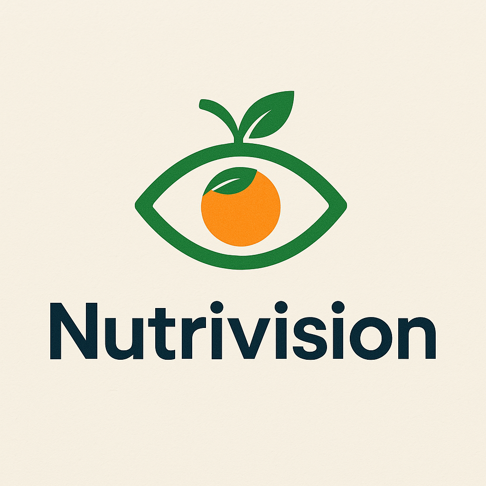
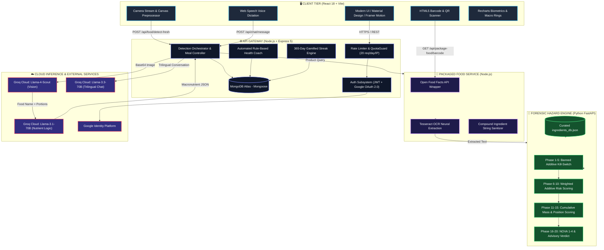
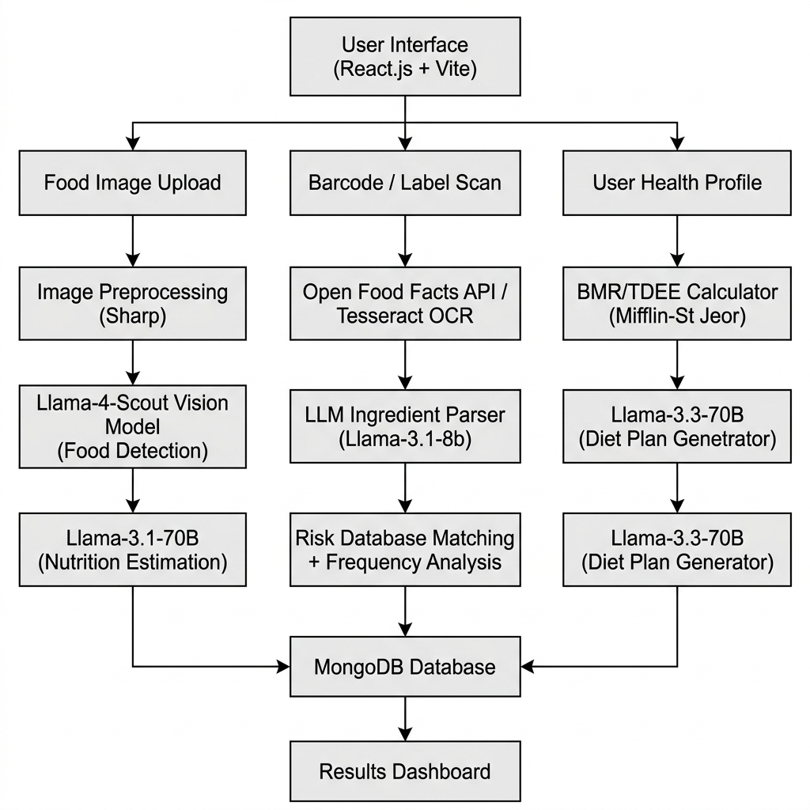

<div align="center">

<!-- HERO WAVE BANNER -->


<br/>

<a href="https://github.com/akkiiop/Nutralyze">
  
</a>

### **Snap a Photo. Scan a Barcode. Know Exactly What Enters Your Body.**

<p align="center">
  <b>An end-to-end AI nutrition intelligence engine combining dual-stage vision reasoning, 20-phase regulatory additive hazard forensics (FSSAI / FDA / EU), and adaptive personalized dietary coaching.</b>
</p>

<!-- BADGES ROW 1: PLATFORM & STACK -->
<p align="center">
  
  
  
  
  
</p>

<!-- BADGES ROW 2: AI & COMMUNITY -->
<p align="center">
  
  
  
  
</p>

<!-- QUICK NAVIGATION PILLS -->
<p align="center">
  <a href="#-quick-preview"><b>Quick Preview</b></a> •
  <a href="#-why-nutralyze"><b>Why Nutralyze?</b></a> •
  <a href="#-core-feature-grid"><b>Core Features</b></a> •
  <a href="#-system-architecture"><b>Architecture</b></a> •
  <a href="#-the-20-phase-hazard-engine"><b>20-Phase Hazard Engine</b></a> •
  <a href="#-empirical-benchmarks"><b>Research Benchmarks</b></a> •
  <a href="#-quick-start"><b>Quick Start</b></a> •
  <a href="#-api-playbook"><b>API Playbook</b></a>
</p>

<br/>

</div>

---

## ⚡ Quick Preview

Experience sub-second multimodal food analysis in action:

```
┌────────────────────────────────────────────────────────────────────────────────────────┐
│  📸 User Uploads Photo (e.g., Masala Dosa with Sambar & Coconut Chutney)              │
│  ⏱️ Total Processing Time: ~820ms                                                      │
├────────────────────────────────────────────────────────────────────────────────────────┤
│  👁️  Llama-4-Scout Vision: Identifies 1 Masala Dosa, 1 Bowl Sambar, 2 tbsp Chutney     │
│  🧠 Llama-3.1-70B Logic:   Calculates 480 kcal | 11g Protein | 68g Carbs | 18g Fats   │
│  🛡️  Zero-Macro Guard:     Validates against physical food density boundaries (PASS)   │
│  🥗 Health Status:         NOVA Group 2 (Culinary Food) | Glycemic Index: Moderate     │
└────────────────────────────────────────────────────────────────────────────────────────┘
```

> [!TIP]
> **Zero Manual Typing**: Point your device's camera at any food plate or packaged food barcode to receive instant nutritional and forensic health reports.

---

## 💡 Why Nutralyze?

Traditional apps (MyFitnessPal, Cronometer, HealthifyMe) require tedious manual logging, rely on closed dictionaries, and completely ignore **harmful food additives, synthetic preservatives, and ultra-processing risks**.

<div align="center">

| Capability | ❌ Traditional Trackers | 🧬 Nutralyze AI Platform |
|:---|:---|:---|
| **Logging Experience** | Manual search & gram guesswork | 📸 **Instant Point & Shoot Camera Capture** |
| **Portion Estimation** | User must weigh on a scale | 🧠 **Volumetric AI Inference (bowls, slices, grams)** |
| **Cuisine Scope** | Limited database (~thousands) | 🌍 **Zero-Shot Open-Vocabulary Global Cuisines** |
| **Ingredient Forensics** | Non-existent (calories only) | 🛡️ **20-Phase Toxic Additive & Regulatory Engine** |
| **Safety Databases** | None | 🏛️ **Cross-referenced with FSSAI, US-FDA, and EFSA** |
| **Ultra-Processing** | Ignored | 🏭 **Automated NOVA Group 1 to 4 Classification** |
| **Languages Supported** | Monolingual (English) | 🌐 **Tri-Lingual Voice & Text (English, हिंदी, मराठी)** |
| **Caloric Accuracy** | Subject to user guess error (±40%) | 🔬 **10.07% Mean Absolute Percentage Error (MAPE)** |

</div>

---

## 🍱 Core Feature Grid

<div align="center">
<table>
<tr>
<td width="33%" align="center">
<br/><br/>
<b>📸 Multimodal Food Recognition</b><br/>
<p align="left">
• Llama-4-Scout (17B) identifies multiple food items on a single plate.<br/>
• Llama-3.1-70B synthesizes USDA/IFCT compositions.<br/>
• Calorie-density fallback prevents zero-macro hallucinations.
</p>
</td>
<td width="33%" align="center">
<br/><br/>
<b>🛡️ 20-Phase Regulatory Engine</b><br/>
<p align="left">
• Instant kill-switch triggers for carcinogenic additives.<br/>
• Evaluates INS codes against FSSAI, FDA, and EU standards.<br/>
• Issues color-coded verdicts: Safe 🟢, Moderation 🟡, Avoid 🔴.
</p>
</td>
<td width="33%" align="center">
<br/><br/>
<b>📦 Packaged Food Intelligence</b><br/>
<p align="left">
• Instant barcode scan via Open Food Facts database.<br/>
• High-accuracy OCR extracts label text on the fly.<br/>
• Normalizes complex compound ingredient arrays.
</p>
</td>
</tr>
<tr>
<td width="33%" align="center">
<br/><br/>
<b>🥗 Dynamic AI Diet Architect</b><br/>
<p align="left">
• Mifflin-St Jeor equation computes personalized BMR & TDEE.<br/>
• Automatically filters allergies (gluten, peanuts, lactose).<br/>
• Dynamically adjusts dinner based on calories already logged today.
</p>
</td>
<td width="33%" align="center">
<br/><br/>
<b>🗣️ Voice-Enabled Chatbot</b><br/>
<p align="left">
• Full conversational fluency in <b>English</b>, <b>हिंदी</b>, and <b>मराठी</b>.<br/>
• Hands-free voice queries using Web Speech Recognition.<br/>
• Retains user biometric profile context during conversations.
</p>
</td>
<td width="33%" align="center">
<br/><br/>
<b>📊 Analytics & 365-Day Streaks</b><br/>
<p align="left">
• Daily calorie rings & macro distributions with Recharts.<br/>
• Gamified streak tracker with automated freeze-day protection.<br/>
• Smart coach alerts when protein dips or sugar spikes.
</p>
</td>
</tr>
</table>
</div>

---

## 🏗️ System Architecture

Nutralyze uses a decoupled, service-oriented architecture where computationally intensive AI inference is isolated from the low-latency web application gateway:



<div align="center">
  
  <p><i>Figure: High-level system dataflow and architectural service boundaries.</i></p>
</div>

---

## 🛡️ The 20-Phase Hazard Engine

Packaged foods hide harmful substances behind obscure names and codes. Our Python FastAPI engine processes ingredients through **20 deterministic analysis phases**:

```
[Ingredient Text] ──▶ Phase 1-5: Kill-Switch ──▶ Phase 6-10: Weighted Score ──▶ Phase 11-15: Toxicity Sum ──▶ Phase 16-20: Final Verdict
```

```
┌─────────────────────────────────────────────────────────────────────────────────────────────────┐
│ 🔴 PHASES 1–5: CRITICAL BANNED ADDITIVE KILL-SWITCH                                             │
│    Instantly halts analysis and emits a RED alert upon detecting globally prohibited substances │
│    • Potassium Bromate (INS 924a)  • Azodicarbonamide (INS 927a)  • BHA (INS 320)  • Titanium D.│
├─────────────────────────────────────────────────────────────────────────────────────────────────┤
│ 🟠 PHASES 6–10: WEIGHTED TOXICITY SCORING (0–100)                                               │
│    Cross-matches chemical synonyms and assigns hazard weights based on clinical studies         │
│    • High-Fructose Corn Syrup (85)  • Artificial Colors Red 40/Yellow 5 (75)  • Aspartame (65)  │
├─────────────────────────────────────────────────────────────────────────────────────────────────┤
│ 🟡 PHASES 11–15: CUMULATIVE MASS & PLACEMENT RATIO                                              │
│    Accounts for ingredient order on the label (earlier ingredients represent higher mass %)     │
│    • Applies decay weight: w_i = (N - i + 1) / N to prevent false alarms on trace additives     │
├─────────────────────────────────────────────────────────────────────────────────────────────────┤
│ 🟢 PHASES 16–20: NOVA CLASSIFICATION & CONSUMPTION ADVISORY                                     │
│    • Group 1: Unprocessed / Minimally Processed Foods (Fresh vegetables, grains, milk)          │
│    • Group 2: Processed Culinary Ingredients (Oils, butter, sugar, salt)                        │
│    • Group 3: Processed Foods (Canned vegetables, salted nuts, cheeses)                         │
│    • Group 4: Ultra-Processed Food (UPF) — Formulations of industrial substances & emulsifiers  │
└─────────────────────────────────────────────────────────────────────────────────────────────────┘
```

---

## 📊 Empirical Benchmarks

Empirical performance evaluation from our research paper:  
*“Nutralyze: A Multimodal LLM-Driven System for Automated Nutrition Analysis, Ingredient Risk Detection, and Personalized Dietary Guidance”*  
Validated against USDA FoodData Central and Indian Food Composition Tables (IFCT):

<div align="center">

| Evaluation Metric | Traditional CNN Baselines | Nutralyze AI Pipeline | Advantage |
|:---|:---:|:---:|:---:|
| **Caloric Estimation Error (MAPE)** | `24.32%` | **`10.07%`** | 🟢 **14.25% lower error** |
| **Protein Estimation Accuracy** | `76.40%` | **`91.20%`** | 🟢 **+14.80% gain** |
| **Carbohydrate Estimation** | `73.10%` | **`89.40%`** | 🟢 **+16.30% gain** |
| **Fat Estimation Accuracy** | `71.80%` | **`88.70%`** | 🟢 **+16.90% gain** |
| **OCR Ingredient Extraction (F1)** | `82.15%` | **`95.98%`** | 🟢 **+13.83% gain** |
| **OCR Precision / Recall** | `84.1% / 80.3%` | **`96.8% / 95.2%`** | 🟢 **Higher recall on small text** |
| **Dish Taxonomy Coverage** | Fixed (101–1,000 classes) | **Open-Vocabulary** | 🟢 **Global & Indian dishes** |
| **Median Inference Latency** | `1,450ms` | **`820ms`** | ⚡ **43.4% faster response** |

</div>

---

## 📂 Project Directory Structure

<details>
<summary><b>📁 Click to Expand Full Annotated Codebase Tree</b></summary>

```
Nutralyze-Complete/
├── client/                              # 🖥️ FRONTEND WEB APP (React 18 + Vite)
│   ├── public/                          # Static images, PWA manifest, and app logos
│   │   ├── images/                      # Branding assets (logo.png, backgrounds)
│   │   └── manifest.json                # Web application manifest
│   ├── src/
│   │   ├── assets/                      # Icons & design tokens
│   │   ├── components/                  # Reusable UI component modules
│   │   │   ├── auth/                    # OAuth & Authentication modal windows
│   │   │   ├── chat/                    # Trilingual ChatBot & Voice inputs (ChatBot.jsx)
│   │   │   ├── common/                  # Buttons, cards, loaders, progress bars
│   │   │   ├── layout/                  # Navbar, Footer, and responsive Sidebar
│   │   │   └── progress/                # Circular progress rings & Rechart wrappers
│   │   ├── config/                      # API endpoints & Axios configuration
│   │   ├── contexts/                    # Global state management (AuthContext, ThemeContext)
│   │   ├── pages/                       # Application Views
│   │   │   ├── PackageFood/             # Barcode scanning, OCR & Harmful report
│   │   │   │   ├── BarcodeScanner.jsx   # Live webcam barcode reader
│   │   │   │   ├── HarmfulReport.jsx    # Visual risk diagnostics
│   │   │   │   ├── PackageFood.jsx      # Barcode/OCR entry hub
│   │   │   │   └── ProductDetails.jsx   # Nutritional breakdown & additive list
│   │   │   ├── Dashboard.jsx            # Biometric dashboard & Health Coach alerts
│   │   │   ├── DietPlan.jsx             # AI Dynamic Diet Generation
│   │   │   ├── FoodScan.jsx             # Real-time Camera Food Capture
│   │   │   ├── MealLog.jsx              # Daily meal records & macro breakdown
│   │   │   ├── Onboarding.jsx           # BMR/TDEE calculation & profile wizard
│   │   │   ├── Profile.jsx              # User health settings & allergies
│   │   │   ├── Progress.jsx             # Historical trend charts & analytics
│   │   │   ├── SignIn.jsx & SignUp.jsx  # Authentication forms
│   │   │   └── Welcome.jsx              # Landing & marketing showcase
│   │   ├── styles/ & theme.js           # Material UI dark/light theme definitions
│   │   ├── App.jsx                      # Route switchboard & protected routes
│   │   └── index.css                    # Global typography & layout rules
│   └── package.json                     # Frontend dependencies
│
├── server/                              # ⚙️ CORE BACKEND GATEWAY (Node.js + Express 5)
│   ├── config/                          # MongoDB Atlas connection pool
│   ├── controllers/                     # Core Business Logic Controllers
│   │   ├── authController.js            # JWT generation & Google OAuth token validation
│   │   ├── chatController.js            # Groq trilingual chat stream handler
│   │   ├── detectController.js          # Dual-stage Llama-4-Scout + Llama-3.1 vision
│   │   ├── dietPlanController.js        # BMR/TDEE calculation & adaptive planning
│   │   ├── harmfulController.js         # Forensic hazard coordination
│   │   ├── mealController.js            # Meal additions, updates & daily totals
│   │   ├── packageFoodController.js     # Barcode & OpenFoodFacts queries
│   │   ├── progressController.js        # Historical analytics aggregation
│   │   ├── streakController.js          # 365-day streak calculation & freeze tokens
│   │   └── userController.js            # Profile updates & macro goals
│   ├── middleware/                      # Auth verification & QuotaGuard rate limiting
│   ├── models/                          # Mongoose Schemas (User, Meal, DailySummary, WeightLog)
│   ├── routes/                          # Express REST API endpoints
│   ├── utils/                           # Calorie density fallbacks & mathematical helpers
│   ├── app.js                           # Express entrypoint
│   └── package.json                     # Server dependencies
│
├── AI-model/                            # 🤖 AI & ML MICROSERVICES
│   ├── ml/                              # Python Machine Learning Subservice
│   │   ├── data/                        # Regulatory databases & datasets
│   │   │   ├── ingredients_db.json      # Curated FSSAI/FDA/EU additive risk database
│   │   │   ├── ingredients_seed.csv     # Raw additive seed dataset
│   │   │   └── build_database.py        # Pipeline to compile and validate the JSON DB
│   │   ├── service.py                   # FastAPI 20-Phase Forensic Hazard Service
│   │   └── __init__.py
│   ├── controllers/                     # Node.js AI controllers (OCR, Barcode)
│   ├── eng.traineddata                  # Tesseract English OCR neural weights
│   ├── requirements.txt                 # Python dependencies (FastAPI, Groq, Pillow)
│   ├── server.js                        # Node.js AI connector service (Port 5000)
│   └── package.json                     # AI-model Node dependencies
│
├── docs/                                # Technical documentation, runbooks & diagrams
│   ├── logo.png                         # High-res application brand logo
│   ├── system_architecture.png          # System architecture flowchart
│   ├── model-selection-playbook.md      # Model capability comparisons
│   └── runbook.md                       # Operational troubleshooting runbook
│
├── Dockerfile                           # Production multi-stage Docker build
├── render.json                          # Render.com Blueprint deployment specification
└── package.json                         # Monorepo orchestration scripts
```
</details>

---

## ⚡ Quick Start

### 1. Prerequisites
- **Node.js** `>= 18.0.0` & **npm** `>= 9.0.0`
- **Python** `>= 3.10.0` & **pip**
- **MongoDB Atlas** database URI ([Free M0 cluster](https://www.mongodb.com/cloud/atlas))
- **Groq API Key** ([Free instant access](https://console.groq.com))

---

### 2. Install Dependencies

```bash
# Clone the repository
git clone https://github.com/akkiiop/Nutralyze.git
cd Nutralyze

# Install all Node dependencies across root, server, client, and AI-model
npm run install-all

# Install Python ML dependencies
cd AI-model
pip install -r requirements.txt
cd ..
```

---

### 3. Configure Environments

Create `.env` in `server/`, `client/`, and `AI-model/`:

```bash
# --- server/.env ---
PORT=8080
CLIENT_URL=http://localhost:5173
MONGO_URI=mongodb+srv://<user>:<password>@cluster.mongodb.net/nutralyze?retryWrites=true&w=majority
JWT_SECRET=super_secret_jwt_key_at_least_32_characters
GROQ_API_KEY=gsk_your_groq_api_key_here
GOOGLE_CLIENT_ID=your_google_oauth_client_id.apps.googleusercontent.com
AI_SERVICE_URL=http://localhost:5000
PYTHON_ML_URL=http://127.0.0.1:8002

# --- client/.env ---
VITE_API_URL=http://localhost:8080/api
VITE_GOOGLE_CLIENT_ID=your_google_oauth_client_id.apps.googleusercontent.com

# --- AI-model/.env ---
PORT=5000
GROQ_API_KEY=gsk_your_groq_api_key_here
```

---

### 4. Run the Platform

```bash
# Terminal 1: Launch Web App, Server & AI Proxy Concurrently
npm run dev

# Terminal 2: Launch Python 20-Phase Forensic Hazard Service
cd AI-model
uvicorn ml.service:app --host 127.0.0.1 --port 8002 --reload
```

| Service | Local URL | Description |
|:---|:---|:---|
| **Frontend Web App** | `http://localhost:5173` | React / Vite Dashboard & Camera UI |
| **API Gateway** | `http://localhost:8080` | Express REST API |
| **Packaged Food Service** | `http://localhost:5000` | OpenFoodFacts & OCR Proxy |
| **Python Hazard Engine** | `http://127.0.0.1:8002/docs` | Interactive Swagger API Documentation |

---

## 🐳 Docker Deployment

```bash
# Build the unified container
docker build -t nutralyze:latest .

# Run containerized platform
docker run -d \
  -p 8080:8080 \
  -e MONGO_URI="your_mongo_connection_string" \
  -e JWT_SECRET="your_jwt_secret" \
  -e GROQ_API_KEY="your_groq_api_key" \
  --name nutralyze-container \
  nutralyze:latest
```

---

## 📡 API Playbook

<details>
<summary><b>📸 POST /api/food/detect-fresh — Visual Food Identification</b></summary>

**Request:** `multipart/form-data` with image file  
**Response (`200 OK`):**
```json
{
  "success": true,
  "data": {
    "foodName": "Paneer Butter Masala with Roti",
    "servingSize": "1 bowl curry + 2 rotis (~380g)",
    "confidence": 0.94,
    "calories": 520,
    "macros": {
      "protein": 18.5,
      "carbs": 54.0,
      "fats": 26.2,
      "fiber": 6.8
    },
    "healthScore": 78,
    "source": "Llama-4-Scout-Vision"
  }
}
```
</details>

<details>
<summary><b>🛡️ POST /api/harmful/analyze-ingredients — 20-Phase Hazard Evaluation</b></summary>

**Request (`application/json`):**
```json
{
  "ingredients": ["Palmolein Oil", "Sugar", "Potassium Bromate", "INS 320", "INS 621"]
}
```

**Response (`200 OK`):**
```json
{
  "success": true,
  "verdict": {
    "color": "Red",
    "level": "High Risk",
    "killSwitchTriggered": true,
    "summary": "Contains Potassium Bromate (carcinogenic banned additive) and BHA (INS 320)."
  },
  "score": 88,
  "novaGroup": 4,
  "hazards": [
    {
      "name": "Potassium Bromate",
      "severity": "Critical",
      "riskScore": 95,
      "status": "Banned in EU, FSSAI; Potential Carcinogen"
    }
  ]
}
```
</details>

<details>
<summary><b>💬 POST /api/chat/message — Trilingual Nutrition Assistant</b></summary>

**Request (`application/json`):**
```json
{
  "message": "माझ्या आजच्या आहारात किती प्रोटीन बाकी आहे?",
  "language": "mr",
  "history": []
}
```

**Response (`200 OK`):**
```json
{
  "success": true,
  "reply": "तुमच्या आजच्या ध्येयानुसार (75 ग्रॅम), तुम्ही दुपारपर्यंत 42 ग्रॅम प्रोटीन घेतले आहे. रात्रीच्या जेवणात अजून 33 ग्रॅम प्रोटीनची आवश्यकता आहे. यासाठी 150 ग्रॅम पनीर किंवा डाळ उत्तम पर्याय ठरेल.",
  "language": "mr"
}
```
</details>

---

## 👥 Research Team & Attribution

Developed at the **Department of Computer Engineering, Dr. Vithalrao Vikhe Patil College of Engineering, Ahilyanagar, India**.

<div align="center">

| Contributor | Role & Domain Focus |
|:---|:---|
| **Akshay B. Kawade** | Project Lead, Multimodal Vision Pipeline & Full-Stack Architecture |
| **Pranav B. Ippalpelli** | 20-Phase Hazard Forensics Engine, Additive DB & FastAPI Services |
| **Pravin B. Wadekar** | Barcode Scanner, Open Food Facts Integration & OCR Subsystem |
| **Dipak J. Baviskar** | Biometric Algorithms, BMR/TDEE Modeling & Streak Analytics |
| **Prof. Narayan B. Vikhe** | Faculty Project Supervisor & Architecture Guidance |
| **Dr. Madhavi S. Kale** | Head of Department & Research Advisor |

</div>

---

## 📜 Citation

```bibtex
@article{nutralyze2026,
  title={Nutralyze: A Multimodal LLM-Driven System for Automated Nutrition Analysis, Ingredient Risk Detection, and Personalized Dietary Guidance},
  author={Baviskar, Dipak J. and Ippalpelli, Pranav B. and Kawade, Akshay B. and Wadekar, Pravin B. and Vikhe, Narayan B. and Kale, Madhavi S.},
  journal={Department of Computer Engineering, Dr. Vithalrao Vikhe Patil College of Engineering},
  year={2026},
  url={https://github.com/akkiiop/Nutralyze}
}
```

---

<!-- FOOTER WAVE -->
<div align="center">
  
  <br/>
  <sub>Built with ❤️ for global food transparency and intelligent preventive healthcare.</sub><br/>
  <sub>© 2026 Nutralyze Research Team. Licensed under the ISC License.</sub>
</div>
