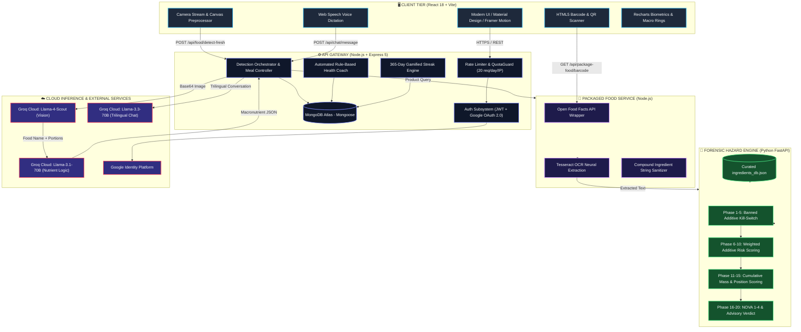

<div align="center">

# 🧬 Nutralyze

### **Next-Gen Multimodal AI Nutrition & 20-Phase Forensic Food Safety Platform**

<p align="center">
  <b>Snap a Photo. Scan a Barcode. Know Exactly What Enters Your Body.</b>
</p>

<p align="center">
  A multimodal full-stack AI platform unifying dual-stage vision reasoning, 20-phase regulatory additive hazard forensics (FSSAI / FDA / EU), and adaptive personalized dietary coaching.
</p>

<br/>

<!-- PRIMARY CTA BADGES -->
<p align="center">
  <a href="https://nutralyze.onrender.com/" target="_blank">
    
  </a>
  <a href="https://nutralyze.onrender.com/" target="_blank">
    
  </a>
  <a href="#-tech-stack">
    
  </a>
</p>

<!-- SECONDARY BADGES -->
<p align="center">
  
  
  
  
</p>

<br/>

<!-- QUICK NAVIGATION -->
<p align="center">
  <a href="https://nutralyze.onrender.com/"><b>🌐 Launch App</b></a> •
  <a href="#-live-demonstration"><b>Live Demo</b></a> •
  <a href="#-why-nutralyze"><b>Why Nutralyze?</b></a> •
  <a href="#-key-features"><b>Key Features</b></a> •
  <a href="#-system-architecture"><b>Architecture</b></a> •
  <a href="#-the-20-phase-hazard-engine"><b>Hazard Engine</b></a> •
  <a href="#-empirical-benchmarks"><b>Benchmarks</b></a> •
  <a href="#-quick-start"><b>Quick Start</b></a> •
  <a href="#-api-playbook"><b>API Docs</b></a>
</p>

<br/>

</div>

---

## 🌐 Live Demonstration

> [!TIP]
> **Production App Live on Render**:  
> Experience real-time food plate scanning, packaged food barcode forensics, and the trilingual AI nutritionist directly in your web browser:  
> 👉 **[https://nutralyze.onrender.com/](https://nutralyze.onrender.com/)**

```bash
# Test the live endpoint via cURL
curl -X POST https://nutralyze.onrender.com/api/food/detect-fresh \
  -F "image=@meal_sample.jpg"
```

```json
{
  "food": "Masala Dosa with Sambar & Chutney",
  "serving": "1 Masala Dosa + 1 Bowl Sambar (~380g)",
  "calories": 480,
  "protein": "11.2g",
  "carbs": "68.4g",
  "fats": "17.8g",
  "safety": "NOVA Group 2 (Culinary Food)",
  "latency": "820ms"
}
```

---

## 💡 Why Nutralyze?

Traditional apps (MyFitnessPal, Cronometer, HealthifyMe) demand tedious manual text searches, guess grams on kitchen scales, and completely ignore **hidden carcinogens, toxic emulsifiers, and ultra-processing risks**.

Nutralyze automates the entire nutrition pipeline from raw pixels to clinical forensic safety reports:

<div align="center">

| Capability | ❌ Traditional Apps | 🧬 Nutralyze Platform |
|:---|:---|:---|
| **Logging Speed** | Manual text query & gram guessing | 📸 **Point camera & snap in sub-second** |
| **Portion Estimation** | User must weigh each item | 🧠 **Volumetric AI Inference (bowls, pieces, grams)** |
| **Cuisine Scope** | Limited static database | 🌍 **Zero-Shot Open-Vocabulary Global Cuisines** |
| **Ingredient Safety** | Non-existent (calories only) | 🛡️ **20-Phase Regulatory Additive Forensics** |
| **Regulatory Checks** | None | 🏛️ **Cross-referenced with FSSAI, US-FDA & EU** |
| **Ultra-Processing** | Ignored | 🏭 **Automated NOVA Group 1 to 4 Classification** |
| **Language Support** | Monolingual English only | 🌐 **Tri-Lingual Voice & Text (English, हिंदी, मराठी)** |
| **Caloric Accuracy** | Subject to user guess error (±40%) | 🔬 **10.07% Mean Absolute Percentage Error (MAPE)** |

</div>

---

## ✨ Key Features

### 📸 1. Multimodal Food Vision & Zero-Macro Guard
* **Dual-Stage Neural Inference**: Preprocesses user photos via `sharp` and pipes them into `Llama-4-Scout-17B` for multi-item identification and portion estimation, followed by `Llama-3.1-70B` for calibrated macronutrient deduction.
* **Anti-Hallucination Guard**: Employs deterministic calorie-density boundaries (`curry = 1.8 kcal/g`, `chips = 5.5 kcal/g`, `salad = 0.4 kcal/g`) to catch and override zero-macro model hallucinations.

### 🛡️ 2. 20-Phase Regulatory Ingredient Hazard Engine
* **Additive Kill-Switch**: Immediately flags carcinogenic or banned substances (e.g., Potassium Bromate / INS 924a, Azodicarbonamide / INS 927a, BHA / INS 320).
* **Multi-Jurisdiction Safety**: Cross-matches ingredient INS numbers and chemical synonyms against FSSAI, US-FDA, and European Commission databases.
* **Tri-Color Safety Verdicts**: Emits clear health classifications — Safe (🟢), Consume in Moderation (🟡), or Avoid (🔴).

### 📦 3. Packaged Food Forensic & Barcode Scanner
* **1M+ Product Database**: High-speed barcode scanning accessing the global Open Food Facts repository.
* **On-Device Label OCR**: Neural Tesseract engine extracts packaging text with Groq-powered compound ingredient normalization.
* **Dual Perspective**: Toggle between standard per-100g and realistic per-serving nutritional metrics.

### 🥗 4. Dynamic Context-Aware AI Diet Planner
* **Mifflin-St Jeor Biometric Engine**: Computes exact BMR and TDEE based on age, gender, height, weight, and activity multipliers.
* **Strict Allergy & Regimen Filters**: Automatically filters allergens (gluten, peanuts, dairy) and dietary styles (Jain, Vegan, Keto, High-Protein).
* **Adaptive Meal Rebalancing**: Dynamically adjusts dinner recommendations based on calories and macros already logged earlier in the day.

### 🗣️ 5. Trilingual Voice-Enabled AI Assistant
* **Multilingual Fluency**: Full conversational capabilities in **English**, **Hindi (हिंदी)**, and **Marathi (मराठी)**.
* **Hands-Free Kitchen Mode**: Integrated browser Speech Recognition (`react-speech-recognition`) for voice dictation while cooking.
* **Profile-Aware Memory**: Injects user health parameters, target deficit, and daily intake context into conversation prompts.

### 📊 6. Biometric Dashboard, 365-Day Streaks & Health Coach
* **Interactive Data Visualization**: Circular progress rings and macro distribution charts powered by Recharts.
* **Gamified 365-Day Streak Engine**: Daily consistency tracker with automated freeze-day protection rules.
* **Automated Health Coach Alerts**: Proactively triggers warnings when protein drops below 60% of target or sugar exceeds daily thresholds.

---

## 🏗️ System Architecture

Nutralyze follows a decoupled, service-oriented architecture isolating compute-heavy AI inference from low-latency user CRUD operations:



<div align="center">
  
  <p><i>Figure: High-level system dataflow and architectural service boundaries.</i></p>
</div>

---

## 🛡️ The 20-Phase Hazard Engine

Packaged food labels conceal hazardous chemicals under complex E-numbers and trade names. Our Python FastAPI engine processes ingredient lists through **20 deterministic analysis phases**:

```
[Ingredient Text] ──▶ Phase 1-5: Kill-Switch ──▶ Phase 6-10: Weighted Score ──▶ Phase 11-15: Toxicity Sum ──▶ Phase 16-20: Final Verdict
```

* **Phases 1–5: Critical Banned Additive Kill-Switch**  
  Instantly triggers a high-severity alert upon detecting banned or carcinogenic additives:
  * Potassium Bromate (`INS 924a`) • Azodicarbonamide (`INS 927a`) • BHA (`INS 320`) • Titanium Dioxide (`E171`)
* **Phases 6–10: Weighted Toxicity Scoring (0–100)**  
  Resolves hundreds of chemical synonyms and weights severity against FSSAI and FDA regulatory standards:
  * High-Fructose Corn Syrup (85) • Artificial Colors Red 40 / Yellow 5 (75) • Aspartame (65)
* **Phases 11–15: Cumulative Mass & Position Ratio**  
  Accounts for ingredient order on the packaging (ingredients listed first constitute higher mass percentages). Decay formula:  
  $$w_i = \frac{N - i + 1}{N}$$
* **Phases 16–20: NOVA Classification & Consumption Advisory**  
  * **Group 1**: Unprocessed or minimally processed whole foods  
  * **Group 2**: Processed culinary ingredients (oils, butter, sugar, salt)  
  * **Group 3**: Processed foods (canned vegetables, cheeses)  
  * **Group 4**: Ultra-Processed Food (UPF) — industrial formulations of additives and emulsifiers  

---

## 📊 Empirical Benchmarks

Empirical performance evaluation from research validation against USDA FoodData Central and Indian Food Composition Tables (IFCT):

<div align="center">

| Metric | Traditional CNN Baselines | Nutralyze AI Pipeline | Advantage |
|:---|:---:|:---:|:---:|
| **Caloric Estimation Error (MAPE)** | `24.32%` | **`10.07%`** | 🟢 **14.25% lower error** |
| **Protein Estimation Accuracy** | `76.40%` | **`91.20%`** | 🟢 **+14.80% gain** |
| **Carbohydrate Estimation** | `73.10%` | **`89.40%`** | 🟢 **+16.30% gain** |
| **Fat Estimation Accuracy** | `71.80%` | **`88.70%`** | 🟢 **+16.90% gain** |
| **OCR Ingredient Extraction (F1)** | `82.15%` | **`95.98%`** | 🟢 **+13.83% gain** |
| **OCR Precision / Recall** | `84.1% / 80.3%` | **`96.8% / 95.2%`** | 🟢 **Superior on curved packages** |
| **Dish Taxonomy Coverage** | Fixed (101–1,000 classes) | **Open-Vocabulary** | 🟢 **Global & Indian dishes** |
| **Median Inference Latency** | `1,450ms` | **`820ms`** | ⚡ **43.4% faster response** |

</div>

---

## 🛠️ Tech Stack

| Domain | Technologies |
|:---|:---|
| **Frontend** | React 18, Vite, Material UI v5, Emotion, Ant Design, Framer Motion |
| **Visualizations** | Recharts, Chart.js, React Circular Progressbar |
| **Scanning** | HTML5-QRCode, React Webcam, Browser Image Compression |
| **Voice Dictation** | Web Speech API, React Speech Recognition |
| **Core Gateway** | Node.js, Express 5, Mongoose, CORS, Dotenv, Sharp, Multer |
| **Authentication** | JWT (JSON Web Tokens), Google Auth Library, Bcrypt.js |
| **Hazard Microservice** | Python 3.10+, FastAPI, Uvicorn, Pydantic |
| **OCR Engine** | Tesseract.js, Tesseract LSTM Neural Network |
| **Large Language Models** | Llama-4-Scout (17B), Llama-3.1-70B, Llama-3.3-70B via Groq Cloud |
| **Database** | MongoDB Atlas (Cloud Cluster) |
| **Deployment** | Docker, Docker Compose, Render.com Blueprint |

---

## 📂 Project Directory Structure

<details>
<summary><b>📁 Click to Expand Annotated Codebase Tree</b></summary>

```
Nutralyze-Complete/
├── client/                              # 🖥️ FRONTEND APPLICATION (React 18 + Vite)
│   ├── public/                          # Static web assets & icons
│   ├── src/
│   │   ├── assets/                      # Icons & design tokens
│   │   ├── components/                  # Reusable UI component modules
│   │   │   ├── auth/                    # OAuth & Authentication modal windows
│   │   │   ├── chat/                    # Trilingual ChatBot & Voice inputs (ChatBot.jsx)
│   │   │   ├── common/                  # Buttons, cards, loaders, progress bars
│   │   │   ├── layout/                  # Navbar, Footer, and responsive Sidebar
│   │   │   └── progress/                # Circular progress rings & Rechart wrappers
│   │   ├── config/                      # API endpoints & Axios configuration
│   │   ├── contexts/                    # Global state management (AuthContext, ThemeContext)
│   │   ├── pages/                       # Application Views
│   │   │   ├── PackageFood/             # Barcode scanning, OCR & Harmful report
│   │   │   │   ├── BarcodeScanner.jsx   # Live webcam barcode reader
│   │   │   │   ├── HarmfulReport.jsx    # Visual risk diagnostics
│   │   │   │   ├── PackageFood.jsx      # Barcode/OCR entry hub
│   │   │   │   └── ProductDetails.jsx   # Nutritional breakdown & additive list
│   │   │   ├── Dashboard.jsx            # Biometric dashboard & Health Coach alerts
│   │   │   ├── DietPlan.jsx             # AI Dynamic Diet Generation
│   │   │   ├── FoodScan.jsx             # Real-time Camera Food Capture
│   │   │   ├── MealLog.jsx              # Daily meal records & macro breakdown
│   │   │   ├── Onboarding.jsx           # BMR/TDEE calculation & profile wizard
│   │   │   ├── Profile.jsx              # User health settings & allergies
│   │   │   ├── Progress.jsx             # Historical trend charts & analytics
│   │   │   ├── SignIn.jsx & SignUp.jsx  # Authentication forms
│   │   │   └── Welcome.jsx              # Landing & marketing showcase
│   │   ├── styles/ & theme.js           # Material UI dark/light theme definitions
│   │   ├── App.jsx                      # Route switchboard & protected routes
│   │   └── index.css                    # Global typography & layout rules
│   └── package.json                     # Frontend dependencies
│
├── server/                              # ⚙️ CORE BACKEND GATEWAY (Node.js + Express 5)
│   ├── config/                          # MongoDB Atlas connection pool
│   ├── controllers/                     # Business Logic Controllers
│   │   ├── authController.js            # JWT generation & Google OAuth token validation
│   │   ├── chatController.js            # Groq trilingual chat stream handler
│   │   ├── detectController.js          # Dual-stage Llama-4-Scout + Llama-3.1 vision
│   │   ├── dietPlanController.js        # BMR/TDEE calculation & adaptive planning
│   │   ├── harmfulController.js         # Forensic hazard coordination
│   │   ├── mealController.js            # Meal additions, updates & daily totals
│   │   ├── packageFoodController.js     # Barcode & OpenFoodFacts queries
│   │   ├── progressController.js        # Historical analytics aggregation
│   │   ├── streakController.js          # 365-day streak calculation & freeze tokens
│   │   └── userController.js            # Profile updates & macro goals
│   ├── middleware/                      # Auth verification & QuotaGuard rate limiting
│   ├── models/                          # Mongoose Schemas (User, Meal, DailySummary, WeightLog)
│   ├── routes/                          # Express REST API endpoints
│   ├── utils/                           # Calorie density fallbacks & mathematical helpers
│   ├── app.js                           # Express entrypoint
│   └── package.json                     # Server dependencies
│
├── AI-model/                            # 🤖 AI & ML MICROSERVICES
│   ├── ml/                              # Python Machine Learning Subservice
│   │   ├── data/                        # Regulatory databases & datasets
│   │   │   ├── ingredients_db.json      # Curated FSSAI/FDA/EU additive risk database
│   │   │   ├── ingredients_seed.csv     # Raw additive seed dataset
│   │   │   └── build_database.py        # Pipeline to compile and validate the JSON DB
│   │   ├── service.py                   # FastAPI 20-Phase Forensic Hazard Service
│   │   └── __init__.py
│   ├── controllers/                     # Node.js AI controllers (OCR, Barcode)
│   ├── eng.traineddata                  # Tesseract English OCR neural weights
│   ├── requirements.txt                 # Python dependencies (FastAPI, Groq, Pillow)
│   ├── server.js                        # Node.js AI connector service (Port 5000)
│   └── package.json                     # AI-model Node dependencies
│
├── docs/                                # Technical documentation, runbooks & diagrams
│   ├── system_architecture.png          # System architecture flowchart
│   ├── model-selection-playbook.md      # Model capability comparisons
│   └── runbook.md                       # Operational troubleshooting runbook
│
├── Dockerfile                           # Production multi-stage Docker build
├── render.json                          # Render.com Blueprint deployment specification
└── package.json                         # Monorepo orchestration scripts
```
</details>

---

## ⚡ Quick Start

### 1. Prerequisites
- **Node.js** `>= 18.0.0` & **npm** `>= 9.0.0`
- **Python** `>= 3.10.0` & **pip**
- **MongoDB Atlas** database URI ([Free M0 cluster](https://www.mongodb.com/cloud/atlas))
- **Groq API Key** ([Free instant access](https://console.groq.com))

---

### 2. Install Dependencies

```bash
# Clone repository
git clone https://github.com/akkiiop/Nutralyze.git
cd Nutralyze

# Install all Node dependencies across root, server, client, and AI-model
npm run install-all

# Install Python ML dependencies
cd AI-model
pip install -r requirements.txt
cd ..
```

---

### 3. Environment Variables Configuration

Create `.env` in each service directory:

```bash
# --- server/.env ---
PORT=8080
CLIENT_URL=http://localhost:5173
MONGO_URI=mongodb+srv://<user>:<password>@cluster.mongodb.net/nutralyze?retryWrites=true&w=majority
JWT_SECRET=super_secret_jwt_key_at_least_32_characters
GROQ_API_KEY=gsk_your_groq_api_key_here
GOOGLE_CLIENT_ID=your_google_oauth_client_id.apps.googleusercontent.com
AI_SERVICE_URL=http://localhost:5000
PYTHON_ML_URL=http://127.0.0.1:8002

# --- client/.env ---
VITE_API_URL=http://localhost:8080/api
VITE_GOOGLE_CLIENT_ID=your_google_oauth_client_id.apps.googleusercontent.com

# --- AI-model/.env ---
PORT=5000
GROQ_API_KEY=gsk_your_groq_api_key_here
```

---

### 4. Run the Platform

```bash
# Terminal 1: Launch Web App, Server & AI Proxy Concurrently
npm run dev

# Terminal 2: Launch Python 20-Phase Forensic Hazard Service
cd AI-model
uvicorn ml.service:app --host 127.0.0.1 --port 8002 --reload
```

| Service | Local Address | Purpose |
|:---|:---|:---|
| **Frontend Web App** | `http://localhost:5173` | React / Vite Dashboard & Camera UI |
| **API Gateway** | `http://localhost:8080` | Express REST API |
| **Packaged Food Service** | `http://localhost:5000` | OpenFoodFacts & OCR Proxy |
| **Python Hazard Engine** | `http://127.0.0.1:8002/docs` | Interactive Swagger API Documentation |

---

## 🐳 Docker Deployment

```bash
# Build the unified container
docker build -t nutralyze:latest .

# Run containerized platform
docker run -d \
  -p 8080:8080 \
  -e MONGO_URI="your_mongo_connection_string" \
  -e JWT_SECRET="your_jwt_secret" \
  -e GROQ_API_KEY="your_groq_api_key" \
  --name nutralyze-container \
  nutralyze:latest
```

---

## 📡 API Playbook

<details>
<summary><b>📸 POST /api/food/detect-fresh — Visual Food Identification</b></summary>

**Request:** `multipart/form-data` with image file  
**Response (`200 OK`):**
```json
{
  "success": true,
  "data": {
    "foodName": "Paneer Butter Masala with Roti",
    "servingSize": "1 bowl curry + 2 rotis (~380g)",
    "confidence": 0.94,
    "calories": 520,
    "macros": {
      "protein": 18.5,
      "carbs": 54.0,
      "fats": 26.2,
      "fiber": 6.8
    },
    "healthScore": 78,
    "source": "Llama-4-Scout-Vision"
  }
}
```
</details>

<details>
<summary><b>🛡️ POST /api/harmful/analyze-ingredients — 20-Phase Hazard Evaluation</b></summary>

**Request (`application/json`):**
```json
{
  "ingredients": ["Palmolein Oil", "Sugar", "Potassium Bromate", "INS 320", "INS 621"]
}
```

**Response (`200 OK`):**
```json
{
  "success": true,
  "verdict": {
    "color": "Red",
    "level": "High Risk",
    "killSwitchTriggered": true,
    "summary": "Contains Potassium Bromate (carcinogenic banned additive) and BHA (INS 320)."
  },
  "score": 88,
  "novaGroup": 4,
  "hazards": [
    {
      "name": "Potassium Bromate",
      "severity": "Critical",
      "riskScore": 95,
      "status": "Banned in EU, FSSAI; Potential Carcinogen"
    }
  ]
}
```
</details>

<details>
<summary><b>💬 POST /api/chat/message — Trilingual Nutrition Assistant</b></summary>

**Request (`application/json`):**
```json
{
  "message": "माझ्या आजच्या आहारात किती प्रोटीन बाकी आहे?",
  "language": "mr",
  "history": []
}
```

**Response (`200 OK`):**
```json
{
  "success": true,
  "reply": "तुमच्या आजच्या ध्येयानुसार (75 ग्रॅम), तुम्ही दुपारपर्यंत 42 ग्रॅम प्रोटीन घेतले आहे. रात्रीच्या जेवणात अजून 33 ग्रॅम प्रोटीनची आवश्यकता आहे. यासाठी 150 ग्रॅम पनीर किंवा डाळ उत्तम पर्याय ठरेल.",
  "language": "mr"
}
```
</details>

---

<div align="center">
  <sub>Built with ❤️ for global food transparency and intelligent preventive healthcare.</sub><br/>
  <sub>© 2026 Nutralyze. Licensed under the ISC License.</sub>
</div>
